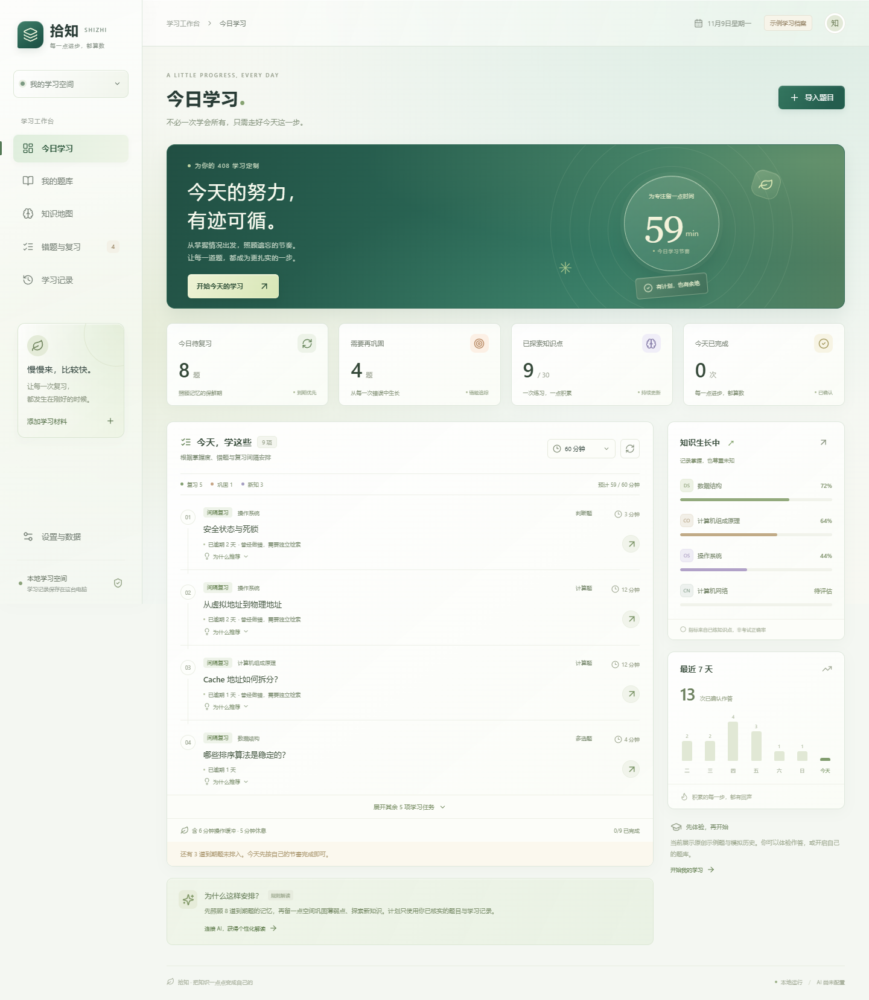
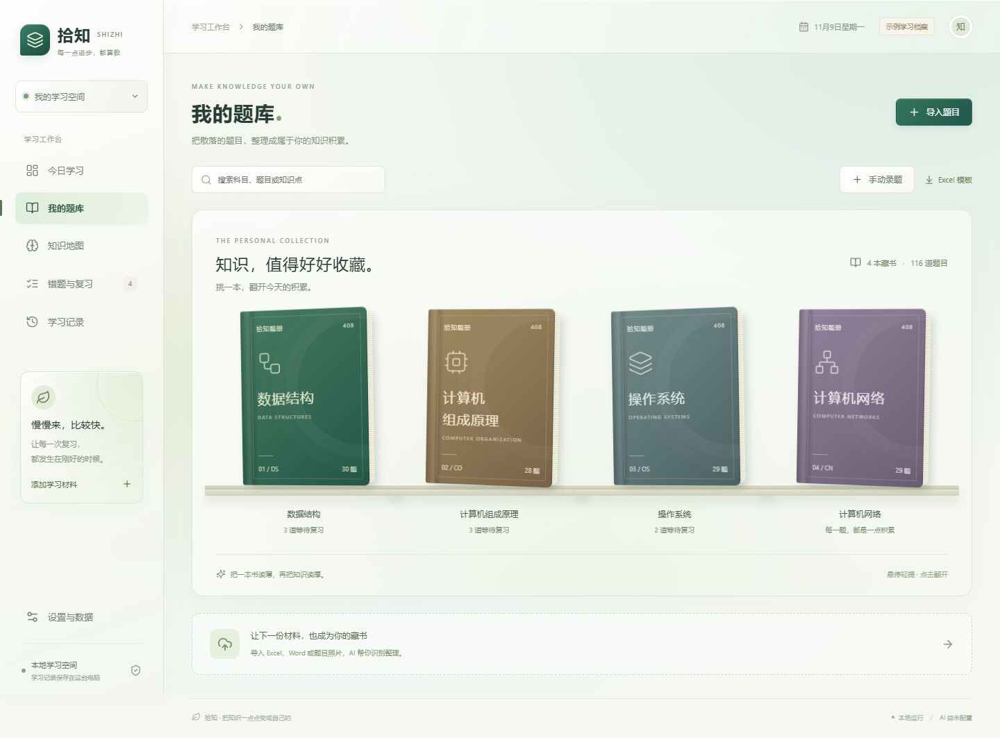
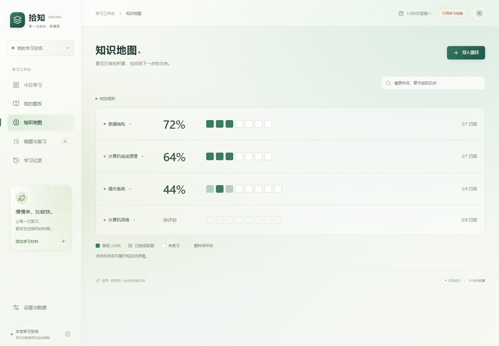
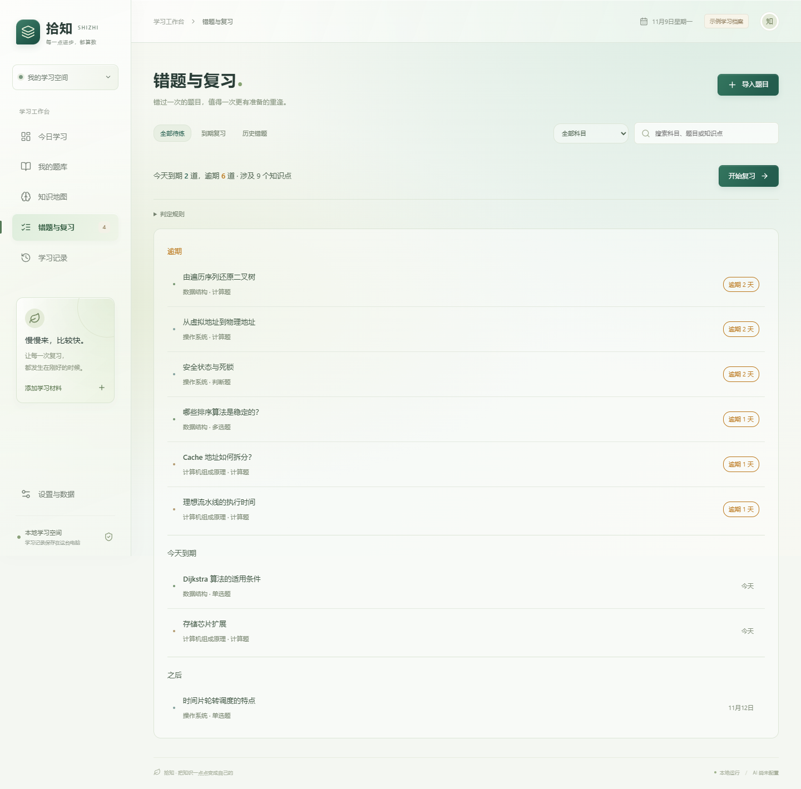
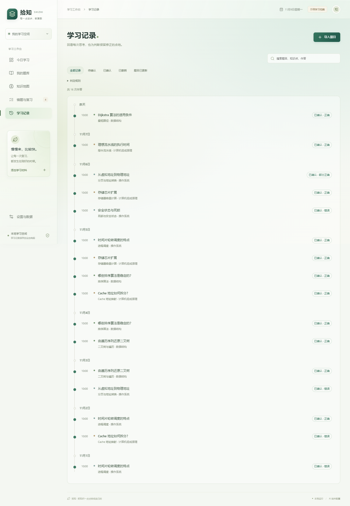
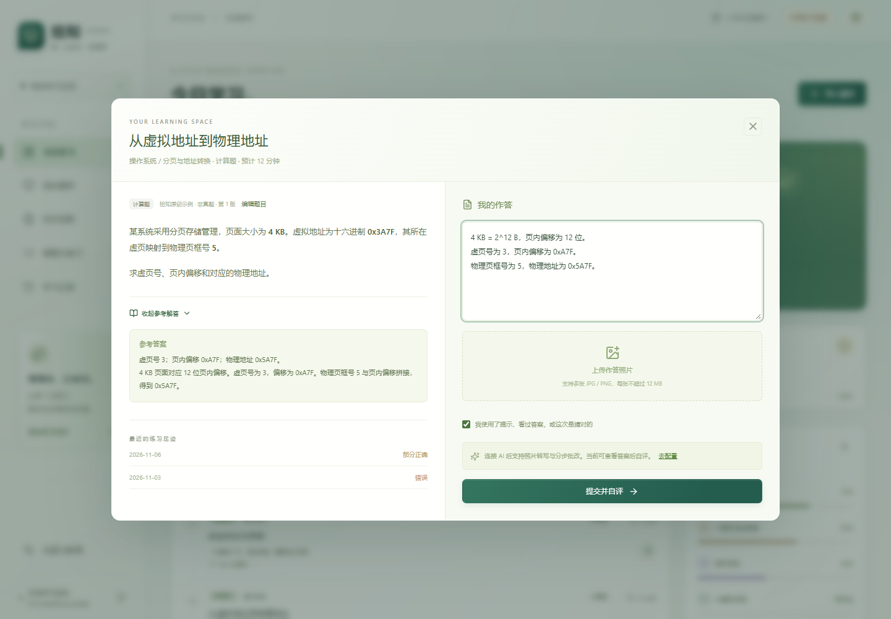
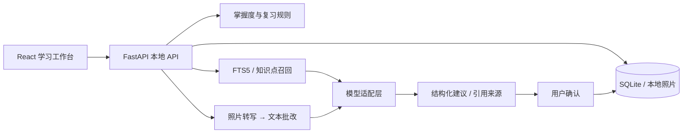

# 拾知 SHIZHI

**面向 408 复习的个人学习工作台：从作答证据安排复习，用 AI 辅助识题、批改和讲解。**

React 19 · TypeScript · FastAPI · SQLite / FTS5 · Chat Completions · MIT

本地运行、单用户使用，无需部署云服务器。未配置模型也可以浏览题库、做客观题、自评和安排复习。



> 截图使用独立数据库中的原创示例题和模拟学习历史，不包含个人资料。真实模型请求需自行配置服务与密钥，可能产生费用。

## 可以做什么

- **安排今天的学习**：依据错题、复习间隔、知识点表现与时间预算选题，展示推荐因素。AI 解释计划，本地规则决定选题与时间。
- **整理个人题库**：标准 Excel 直接解析；Word、非标准 Excel、JPG / PNG 可交给支持相应输入的模型整理，校对后入库。
- **照片分步批改**：先转写照片，再基于转写和参考答案形成步骤评价；支持修正识别文字后重批，最终由用户确认。
- **RAG 题库讲解**：用 FTS5 和知识点匹配召回已核实题目，结合已确认历史生成讲解，展示引用题目和再练建议。
- **观察学习进度**：书架式题库、知识点覆盖矩阵、按紧迫度分组的复习队列和按日期分组的学习时间线。
- **保留可追溯记录**：题目版本快照、判分修订、撤销与恢复、草稿冲突检测、数据库和照片完整备份。

## 界面预览

| 题库书架 | 知识点覆盖矩阵 |
| --- | --- |
|  |  |

| 错题与复习队列 | 学习记录时间线 |
| --- | --- |
|  |  |



## 快速开始

环境：Python **3.11+**、Node.js **20.19+ 或 22.12+**、npm。当前本机验证环境为 Windows / Python 3.13；仓库附带 Windows 和 Ubuntu 的 CI 工作流，云端结果以 GitHub Actions 实际运行结果为准。

### 1. 获取代码

```sh
git clone https://github.com/Diagonal111/-.git shizhi-study
cd shizhi-study
```

### 2. 安装依赖

```sh
python -m venv .venv
```

激活虚拟环境（按系统选择）：

```powershell
# Windows PowerShell；如果执行策略不允许激活，可直接使用 .venv\Scripts\python.exe
.\.venv\Scripts\Activate.ps1
```

```sh
# macOS / Linux
source .venv/bin/activate
```

然后安装并构建：

```sh
python -m pip install -r requirements-dev.txt
npm ci
npm run build
python run.py
```

打开 <http://127.0.0.1:8765>。Windows 也可在依赖安装后双击 `start-study.cmd`。

开发前端时另开终端执行 `npm run dev`，访问 <http://127.0.0.1:5173>。后端热重载启动方式：

```sh
python -m uvicorn backend.main:app --host 127.0.0.1 --port 8765 --reload
```

首次使用载入 **16 道原创示例题与模拟作答**。额外的 **100 道 408 原创练习题**（四科各 25 道）需手动安装：

```sh
python -m backend.practice_bank
```

重复安装只补缺失题目，安装前自动备份。题集是基础巩固材料，非历年真题，不代表完整考试范围。开启个人题库或首次正式录题会清理 16 道示例题和示例历史，保留额外安装的 100 道练习题。

## 连接 AI

在「设置与数据 → 连接 AI」中配置服务基础地址、**API 模型 ID** 与 API Key。程序会追加 `/chat/completions`。

以 DeepSeek 官方 Flash 接口为例（请以服务商当时的文档和账户权限为准）：

| 参数 | 示例 |
| --- | --- |
| 基础地址 | `https://api.deepseek.com` |
| 模型 ID | `deepseek-flash` |
| API Key | 在页面中输入自己的密钥 |
| JSON 输出 | 服务支持时开启；不支持时关闭 |

模型 ID 不是显示名称，`ds` 或 `deepseek v4.1 flash` 无法作为 API 模型 ID。纯文本计划解读与 RAG 讲解可用文本接口；**照片识别需所选模型及服务支持图片输入**。不是所有兼容接口或模型都有视觉能力。

密钥仅保存在后端运行期间的内存，也可通过 `STUDY_API_KEY` 环境变量提供。密钥不会返回浏览器、写入数据库或进入备份。重启后端后，页面输入的密钥需要重新填写。`.env` 文件不会自动加载。

AI 结果是建议，只有确认作答后才更新学习状态。配置保存只表示参数已保存，不等于已验证连通性。当前手动验证过真实 DeepSeek 文本请求，照片识别、批改质量及 RAG 效果尚无正式评测指标。

## 工程设计



- **状态可重算**：基于已确认、带版本快照的作答重建掌握度和复习状态。同日重复练习降低权重，提前练习不推迟原复习日。
- **写入受控**：重复确认幂等；版本变更、恢复数据或作答状态变更时，拦截过期 AI 结果。
- **RAG 边界清楚**：当前采用字符级中文检索、BM25 和同知识点优先，过滤未核实及跨科目题目；不包含向量检索或语义重排。引用 ID 校验不能证明模型结论一定被原文支持。
- **备份可恢复**：校验文件哈希、数据结构、照片引用和关联完整性，恢复前自动备份，失败时回滚。

实现细节见 [架构与边界](docs/架构与边界.md)，完整早期方案见 [系统设计](docs/个性化刷题学习系统设计.md)。早期方案包含未实现内容，以本文与现有代码为准。

## 测试

```sh
npm ci
npm run build
python -m pip install -r requirements-dev.txt
python -m pytest -q
```

自动化测试使用临时数据库，覆盖确认幂等、状态重算、复习间隔、题目版本、草稿并发、备份恢复及回滚、分享权限、模型协议与错误提示、照片两阶段流程和 RAG 检索过滤。AI 测试使用模拟响应，不会调用收费服务；测试通过不代表模型准确率。

## 数据与分享

- 默认数据位置：Windows 为 `%LOCALAPPDATA%/ShizhiStudy`；其他系统为 `~/ShizhiStudy`。可用 `STUDY_DATA_DIR` 指定目录。
- 通过「设置与数据」导出或恢复数据库和照片。个人数据库、图片和备份不属于代码仓库。
- Windows 下可用 `start-share.cmd`，或运行 `python share.py` 创建带口令的 Cloudflared 临时演示。演示使用独立数据目录，禁用 AI、上传与管理操作；电脑和进程需要持续运行。
- 首次分享会下载并校验 Cloudflared 客户端。此功能没有在所有系统上验证，不等同于生产环境部署。

更多操作见 [使用指南](docs/使用指南.md)。安全说明见 [SECURITY.md](SECURITY.md)。

## 当前范围

这是持续完善的个人项目，暂不提供多用户账户、跨设备同步、持久化后台任务、MCP、向量检索或正式学习效果评测。上传暂支持 `.xlsx`、`.docx`、JPG 和 PNG，**不支持 PDF、`.doc` 或 `.xls`**。导入限制、复杂公式识别和图片对应关系需人工校对。

后续优先补充真实检索与批改评测、可恢复工作流和逐条可定位的引用。

## 许可证

[MIT](LICENSE) © 2026 wqh ([Diagonal111](https://github.com/Diagonal111))。仓库练习题为原创示例；用户自行导入材料的权利归原权利人，请勿提交付费教材或个人作答资料。
