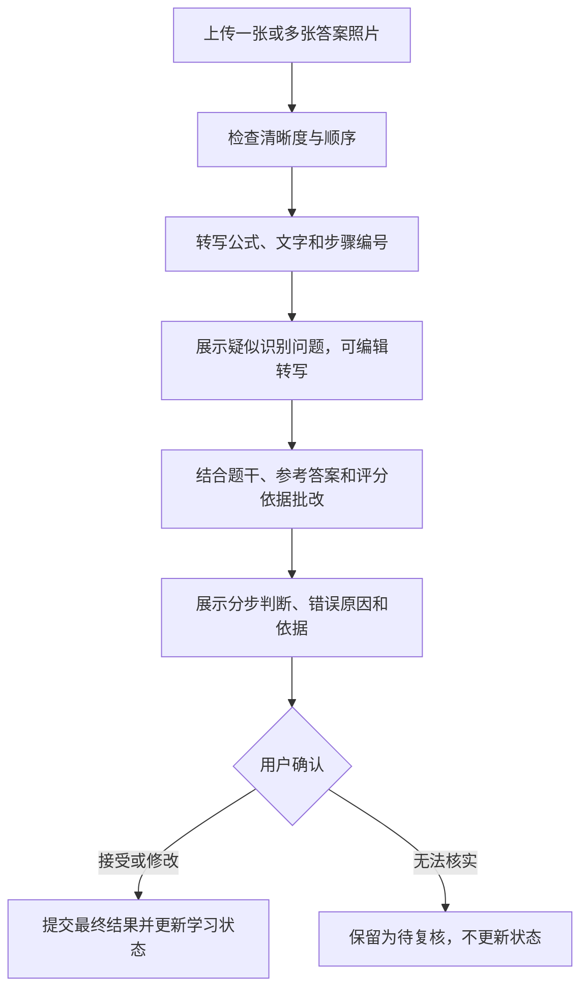

# 个性化刷题学习系统设计

版本：v0.1 · 2026-10-29 · 面向个人使用的本地网页应用

## 1. 产品定位与已确认需求

这是一个帮助个人安排每日刷题与复习的学习工具。系统根据知识点掌握情况、历史错题和复习间隔，计算当天值得做的题目，再由 AI 生成有依据、可调整的学习计划。

首个使用场景为计算机 408 备考，覆盖数据结构、计算机组成原理、操作系统、计算机网络。知识点体系可编辑，以便以后扩展到其他学科。

已确认的需求：

| 维度 | 设计结论 |
| --- | --- |
| 使用对象 | 个人自用，围绕个人题库和学习记录运行 |
| 使用方式 | 在本机启动后，通过浏览器打开；无需购买或部署远程服务器 |
| 题目来源 | Excel、Word、题目照片，由程序与 AI 协作识别整理 |
| 主要题型 | 计算题、选择题、判断题；选择题兼容单选和多选 |
| 计算题提交 | 拍照上传手写或纸面作答，也支持补充文字 |
| 批改方式 | AI 识别答案与步骤、辅助批改，用户确认或修正结果 |
| 计划依据 | 知识点掌握度、错题状态、复习时间、可用学习时长 |
| AI 职责 | 识别整理题目、辅助批改、解释计划、提供受控的调整建议 |

本文默认采用“本机数据存储 + 可配置的云端多模态模型”。模型调用需要网络，题目和作答图片会发送给所选模型服务；本地模型作为后续适配方向。具体模型在实现时按图片识别、中文公式理解、结构化输出和成本表现选择。

暂不做账号体系、多人协作、班级管理、排行榜、付费系统和云端同步。PDF 批量导入列为后续扩展，不影响 Excel、Word、照片的首版交付。

## 2. 核心目标与成功标准

用户每天只需要完成四件事：设定今天可用时间，查看并调整计划，完成题目，确认批改结果。系统应能回答：

1. 今天具体做哪些题，预计需要多久？
2. 每个任务为什么排在今天，依据是哪条学习记录？
3. 这次作答改变了哪些知识点状态，下一次什么时候复习？
4. 时间不够、题库不足或 AI 不可用时，如何继续学习？

首版的成功标准是形成可用闭环：**导入题目 → 校对入库 → 生成计划 → 作答与批改 → 确认结果 → 更新掌握度和复习日期 → 后续计划使用新状态。**

掌握度是排序用的估计指标，不应展示为“考试答对概率”。初期重点验证推荐是否有据可查、时间是否可执行、错题是否持续得到复习，学习提分效果需要后续积累数据验证。

## 3. 总体方案


系统分为两类决策：

- **程序负责可验证的计算：**答案匹配、状态更新、复习日期、任务排序、时间预算、去重和先修约束。
- **AI 负责内容理解与表达：**解析非结构化题目、理解作答步骤、提出批改建议、引用证据解释计划。

AI 不能直接修改掌握度、复习日期或已发布的计划。所有影响学习状态的修改，都由后端校验后执行。

## 4. 主要使用流程

### 4.1 首次使用

1. 选择“408”知识点模板，勾选要学习的科目。
2. 设置每日默认学习时长，例如 60 分钟；考试日期可选。
3. 导入一批 Excel、Word 或题目照片。
4. 校对识别结果，确认题型、答案和知识点。
5. 系统安排少量基础题或混合诊断题，建立初始记录。
6. 后续根据实际作答逐步调整计划。

没有作答记录的知识点显示“待评估”。系统允许用户提供自评作为初始化参考，但明确标注来源，优先用后续独立作答替换这类弱证据。

### 4.2 每日学习

1. 用户进入“今天”，确认今日可用时间。
2. 系统展示到期复习、薄弱点巩固和新知识练习任务。
3. 用户可以调整顺序、锁定任务、替换同知识点题目或减少时长。
4. 进入任务后，按题作答；计算题可上传多张连续作答照片。
5. AI 返回转写内容、分步批改和知识点建议，用户确认后入账。
6. 页面展示本次变化，例如“页表地址转换：待评估 → 仍需巩固；该题明天复习”。

当天未完成的任务保留记录，下一天根据最新状态重新排序，避免把所有未完成内容机械叠加到新计划。

### 4.3 AI 或网络不可用

仍可浏览题库、按现有数据生成规则计划、完成客观题、查看已有答案并手动确认结果。新导入材料和照片批改保存为待处理任务，联网后可重试；用户也可以主动转为人工录入或自评。

## 5. 题目导入设计

### 5.1 输入范围

| 输入 | 处理方式 | 首版边界 |
| --- | --- | --- |
| Excel `.xlsx` | 提取单元格、工作表结构和嵌入图片；AI 整理非标准排版 | 支持多题、多工作表；预览列映射和题目边界 |
| Word `.docx` | 提取段落、表格、公式相关信息和嵌入图片；AI 按上下文拆题 | 复杂公式或版式需转为图片识别并人工校对 |
| 照片 `.jpg/.jpeg/.png` | 校正方向、压缩、必要时裁剪；多模态模型识别题干、图表和公式 | 支持一图多题、一题多图，拆分和合并结果可调整 |
| 旧版 `.xls/.doc` | 引导另存为 `.xlsx/.docx` | 首版不隐式依赖本机 Office 完成格式转换 |
| PDF | 后续按页渲染和识别 | 第二阶段按实际材料需求增加 |

Excel、Word 优先利用原有文字和结构，再把图片、公式或复杂区域交给视觉模型。程序负责读取材料，AI 负责把材料整理成统一题目结构。

Word 中无法可靠提取的公式、浮动对象或扫描内容，必须在预览中提示缺失并允许补图。首版不承诺无损还原任意 Office 排版。Excel 公式没有可用缓存结果时提示校对，不执行宏和外部链接。

### 5.2 导入状态

`已上传 → 本地解析 → AI 识别 → 待校对 → 已入库`

失败任务保留原文件、成功结果和失败原因，可以重试失败部分。大文件按工作表、题目组或图片分批处理，每批保存检查点。

单次导入的文件数、文件大小和模型预算设置上限；具体值由所选模型能力和本机体验测试确定，不直接把整本材料发送给模型。

### 5.3 统一题目结构

每道题包含：

- 题干：Markdown 文本，公式使用 LaTeX，关联图表作为附件。
- 题型：单选、多选、判断、计算。
- 选项：稳定的选项 ID 与显示文本。
- 参考答案、参考解析、来源及其校验状态。
- 知识点：一个主知识点及可选的辅助知识点。
- 难度、预计作答时间：允许 AI 提议，用户可改。
- 原始定位：文件、工作表与单元格范围，或 Word 段落/表格位置，或照片区域。
- 识别问题：模糊字符、缺图、疑似漏项、答案缺失等。

原始内容和整理结果并排显示；用户可快速修正 `0/O`、`1/l`、二进制、上下标、正负号、单位、选项和图中数字。

### 5.4 入库与答案可信度

题目内容和参考答案分别维护状态：

| 状态 | 含义 | 允许行为 |
| --- | --- | --- |
| `draft` | 内容尚未校对 | 编辑、补图、拆分或合并 |
| `ready + answer_verified` | 内容可用且参考答案已确认 | 可进入正式练习和自动判分流程 |
| `ready + answer_unverified` | 题目可用，答案缺失或仅为 AI 推导 | 可练习、可请求 AI 解析；结果待核实，不自动更新掌握度 |
| `archived` | 已停用或确认重复 | 不生成新任务，保留历史记录 |

AI 推导的答案必须标明来源，不能直接标为已验证。用户可在补充可靠答案或独立核实后确认；无参考答案时，AI 只能给出暂定批改意见。

选择题检查选项是否齐全、答案是否指向有效选项；判断题统一为真/假；计算题允许数值、单位、公式、文字说明和多小问组成答案。首版不强制每道计算题都有结构化评分细则。

### 5.5 重复题处理

文件哈希用于发现重复上传；标准化题干、选项和图片信息用于发现疑似重复题。相似题先提示用户合并或保留，AI 相似度不能触发自动删除。

如果只是换了数值或问法，可保留为不同题目并归入同一变式组。后续掌握度计算会降低短时间内重复相同题目的证据权重。

## 6. 作答识别与批改

### 6.1 客观题

用户选择答案后，由程序与已确认的参考答案比较。多选题首版按完全匹配判正确，漏选、多选、错选均记录为错误，另行保存具体差异。若以后需要部分得分，增加明确的题目级评分规则。

正确不一定代表掌握。用户可以标记“猜对”或“看过提示”；这类作答降低证据权重。只上传答案照片时，先识别选项，再让用户确认识别值。

### 6.2 计算题拍照批改



识别与批改是逻辑上的两个阶段。清晰图片可连续处理，但应始终提供“查看和修改 AI 转写”的入口；存在关键歧义时，先校对，再提交批改。

### 6.3 批改结果结构

| 字段 | 含义 |
| --- | --- |
| `transcription` | AI 识别出的作答内容，保留步骤编号和图片引用 |
| `grade` | 正确、部分正确、错误、无法判定 |
| `score / max_score` | 可选；只有参考评分细则存在时才给出正式分数建议 |
| `step_reviews` | 每步的原文引用、判断、说明及参考依据 |
| `first_error_step` | 首个有依据的错误步骤；无法确定时为空 |
| `error_types` | 概念、方法、公式、计算、审题、书写或其他，可多选 |
| `knowledge_assessments` | 本次实际考查的知识点及各自表现 |
| `uncertainties` | 模糊数字、缺失步骤、参考答案冲突等问题 |
| `reference_status` | 使用了什么答案或细则、是否经过确认 |

不把“AI 自报 95% 置信度”当成正确性保证。优先呈现可核对的步骤、依据和具体不确定项。

### 6.4 批改规则

- 允许不同于参考解析的有效解法，不能仅因步骤不同判错。
- 计算错误和概念错误分别记录；出现中间错误后，后续推导可标注“基于前一步结果继续推导”，避免重复扣同一个错误。
- 正确答案但过程缺失，标注“结果正确、过程未充分验证”；不要据此断言所有相关知识点都已掌握。
- 缺单位是否影响判断，依据题目要求和确认的评分规则处理。
- 无法辨认的关键数字、缺页、题干条件不足或参考答案冲突时，返回“无法判定”或要求补充信息。
- 本次未实际考查的辅助知识点不更新；AI 不能把题目上的全部标签都视为已验证。
- 页面在确认前展示“本次将更新哪些知识点、下次何时复习”的预览；用户可修改结论、错误类型和知识点归因。

### 6.5 结果生效与更正

作答记录经历 `草稿 → 已提交 → AI 待处理 → 待确认 → 已确认`，也支持人工直接确认。只有已确认且答案依据已核实的结果，才进入正式学习状态计算。

确认、更正、撤销采用唯一请求键和版本校验，避免重复点击或多个浏览器标签重复计入。更正不覆盖原始图片和 AI 输出；系统保留修订版本，并从有效记录重算相关知识点、错题状态和复习安排。

重算使用作答实际提交时间排序，时间相同时按稳定 ID 排序；确认时间和修订时间另行保存。隔天确认或更正旧结果不会被当成今天重新做了一遍题。若重算后的复习日期已过，按逾期处理；历史计划保留原快照，当前未完成计划可提示重新生成。

## 7. 知识点与掌握度

### 7.1 知识点体系

采用“科目 → 章节 → 具体知识点”树形结构，另用关系表表示先修依赖。例如：

```text
计算机组成原理
└─ 存储系统
   ├─ 地址与容量计算
   ├─ Cache 地址映射
   └─ Cache 命中率与平均访问时间

操作系统
└─ 内存管理
   ├─ 分页与页表
   └─ 虚拟地址到物理地址转换
```

模板只是初始分类，用户可改名、增删和合并。先修关系区分“建议先学”和“必须先学”，首版优先采用建议关系；只有用户明确设置的硬依赖才阻止新知识练习。保存时检查依赖环路。

### 7.2 首版掌握度计算

使用可解释的加权证据累计模型，便于个人小数据场景启动。它是工程基线，尚未经过学习效果校准。

每个知识点维护两个参数：

```text
初始：alpha = 1，beta = 1
掌握度指标 M = alpha / (alpha + beta)
有效证据量 N = alpha + beta - 2

每条已确认的有效表现：
alpha += w × r
beta  += w × (1 - r)

r：正确 1，部分正确 0.5，错误 0
w：本次证据权重，范围 [0, 1]
```

`w` 综合实际考查程度、是否独立完成、是否为短期重复作答。一次作答涉及多个知识点时，分配的贡献权重总和不超过 1；如果分步判断足够清楚，则为各点保存不同的 `r`。首版不引入未经验证的难度加分。

默认权重规则：独立首次作答系数为 1；看提示、答案后完成或自报猜对为 0.25；同一题或已确认的变式组在同一自然日第二次作答再乘 0.2，之后乘 0。规则参数可配置并记录版本。猜对不用于增加复习间隔，按需独立重做处理。

初始值虽然为 0.5，但界面显示“待评估”。有效证据量小于 3 时，显示“证据较少”，不凭少量题目下确定结论。例如只做对一道题，指标约为 0.67，仍属于证据较少。

暂用区间展示：低于 0.5 为“需加强”，0.5～0.75 为“巩固中”，大于等于 0.75 为“较熟练”。低证据状态优先于这些标签。阈值是可调整的产品参数。

### 7.3 长期表现与近期遗忘分开记录

首版的 `M` 表示累计作答表现，复习紧迫度表示距离上次有效检索的时间。界面可以同时显示：

> Cache 映射：较熟练；有 2 道题到期，需要检索复习。

不因为时间过去就伪造错误记录，也不因为历史正确率高就忽略复习间隔。后续数据足够时，可比较近期加权表现、知识追踪或更成熟的间隔算法，迁移前保留历史事件和算法版本。

## 8. 错题与间隔复习

### 8.1 错题是原题的学习状态

错题本引用同一道题和作答历史，避免复制题目造成版本分裂。记录首次出错、最近错误类型、最近复习、连续独立答对次数和下次复习日期。

状态建议：`待订正 → 待复习 → 巩固中 → 已稳定`。已稳定后再次出错，重新进入待订正。

默认“已稳定”条件：至少在 3 个不同自然日独立答对，且其中一次发生在至少 7 天的计划间隔后。这个标签只表示该题的复习状态；知识点是否迁移掌握，还要参考其他题目或变式表现。

### 8.2 首版复习间隔

以题目为单位维护复习安排，知识点聚合相关题目的到期情况。先用固定间隔基线：

```text
间隔序列：1、3、7、14、30、60 天
```

| 已确认结果 | 阶段与下次复习 |
| --- | --- |
| 首次完成且正确 | 阶段 0，1 天后复习 |
| 到期附近独立答对 | 阶段前进一级，使用对应间隔，上限 60 天 |
| 部分正确或错误 | 阶段重置为 0，1 天后复习；进入相应错题状态 |
| 依赖提示或答案完成 | 阶段重置为 0，1 天后独立重做 |
| 提前独立答对 | 保持原阶段和原复习日期，避免短期重复延长间隔 |
| 无法判定或未确认 | 不改变复习安排 |

“到期附近”默认指距离上次有效复习已达到原计划间隔的 80%；首版按本地自然日差计算经过天数，避免昨晚作答、今早到期时被误判为提前练习。具体阈值统一配置。上次有效复习时间、阶段、原计划间隔和下次日期均持久化，避免重启后重算漂移。

错误后可以当天看解析、订正或做变式，但当天订正不等于完成次日独立复习，不用于增加间隔。用户主动跳过或延后任务属于计划操作，不计为答错，也不算成功复习。

系统按个人时区计算自然日，默认 `Asia/Shanghai`，底层时间戳使用 UTC。今天结束前到期的题可列为今日候选；晚间完成后的“1 天后”在下一个本地自然日安排。

## 9. 今日计划算法

### 9.1 输入与输出

输入包括：今日时间预算、科目偏好、可选考试日期、知识点状态、题目可用性、错题和到期记录、最近计划、用户锁定任务及排除项。

输出是一组具体任务，包含题目 ID、知识点、任务类型、预计时间、推荐依据和可替换范围。AI 生成的文字不能替代这些结构化任务。

### 9.2 候选任务

候选分为四类：

1. 到期或逾期复习：按题目复习记录产生。
2. 薄弱点巩固：从近期错误和低掌握度知识点选择题目。
3. 新知识练习：从未练过且先修条件允许的知识点选择基础题。
4. 诊断与迁移：针对证据不足或只反复做对同一道题的知识点，选择未见题或变式。

“学新知识”在首版具体表现为基础题尝试、参考解析学习和再次练习。系统不自动假定存在课程视频或教材，也不把浏览解析计为已掌握。

候选只能使用已确认可用的题目和答案。缺少合适题目时，提示补充该知识点题库；AI 自动出题不纳入首版主流程。

同一道题只生成一个候选，合并“复习到期、曾经做错、知识点薄弱”等理由。展示完整理由，计算时不因命中多个列表而重复增加任务。

### 9.3 优先级基线

以下权重为首版启发式参数，需要通过个人使用反馈调整：

```text
priority = 100 × (
    0.35 × D +
    0.25 × W +
    0.20 × E +
    0.10 × G +
    0.10 × S
)
```

| 因子 | 范围 | 定义 |
| --- | --- | --- |
| D 复习紧迫度 | 0～1 | 无复习记录为 0；未来到期为 0～0.5；今日到期为 0.7；逾期后按原间隔归一化增加，最高 1 |
| W 薄弱程度 | 0～1 | 证据充分时为 `1-M`；证据不足时使用中性值 0.5，并通过诊断任务补充信息 |
| E 错题需要 | 0～1 | 待订正 1、待复习 0.8、巩固中 0.4、其余 0；默认值可配置 |
| G 目标相关性 | 0～1 | 根据用户科目/章节优先级计算；未设置时统一使用中性值 |
| S 等待补偿 | 0～1 | 候选连续未被安排的可学习天数除以 7，上限 1；防止低优先级任务长期被忽略 |

逾期因子可实现为 `min(1, 0.7 + 0.3 × 逾期天数 / max(1, 原间隔天数))`。未到期因子按已过间隔比例映射到 `[0, 0.5]`。同分时优先更早到期，再使用稳定的题目 ID 排序。

一次错误会同时影响 `M` 和错题状态，但两者分别表示历史表现与当前纠错需要。它们用于同一候选的有界加权，不重复计作两次作答。

### 9.4 时间预算与任务选择

题型默认时间可先取：选择/判断 3 分钟、计算题 12 分钟；之后用个人同题型或同知识点的历史中位数调整。时间只用于估算，不因超时直接判错。

从用户总预算中预留约 10% 给拍照、确认批改和切换；较长计划可安排休息，休息也计入总时长。每个任务的估算包含作答和简短复盘。

默认把可学习时间分配为“到期复习 50%、薄弱巩固 30%、新题与诊断 20%”。这是选题倾向，不是必须填满的配额；一题多重属性只占用一次时间。无合适候选时，可把剩余预算借给其他类别。

选择过程：

1. 放入用户已锁定且仍有效的任务，扣除其预算。
2. 在各类别中按优先级选择可放入的任务；同时检查先修条件、题目状态和重复情况。
3. 每轮选择后更新剩余预算与知识点覆盖，避免所有任务挤在同一知识点。
4. 对剩余空间执行一次补位选择；首版使用贪心启发式，不承诺全局最优。
5. 校验任务用时、休息和缓冲总和不超过用户预算。

复习大量积压时，优先处理逾期与反复出错题，并展示剩余积压；可在有合适新题且用户允许时保留少量新题。不会为了“清空逾期”无限加长计划。

锁定任务本身超过预算时，展示时间冲突并请用户缩减或增加时间，确认前保留草稿。只有 10 分钟时生成微型计划；一整道计算题放不下时可换短题，或在题目存在独立小问时拆成明确的小问任务，不能随意截断完整题目。

### 9.5 可解释性

每个任务先由程序产生事实型理由，例如：

```json
{
  "task_id": "task_101",
  "question_ids": ["q_42"],
  "knowledge_ids": ["kp_cache_mapping"],
  "estimated_minutes": 12,
  "reason_codes": ["DUE_TODAY", "RECENT_CALCULATION_ERROR"],
  "evidence": [
    {"type": "review_due", "date": "2026-10-29"},
    {"type": "attempt", "id": "attempt_27", "date": "2026-10-26", "result": "incorrect"}
  ]
}
```

AI 将这些事实组织为易读说明，例如：“今天复习 Cache 映射：这道题已到复习日，上次错在地址字段位数计算，建议先独立完成，再核对拆分过程。”说明中的事实可点击回到原始记录。

界面允许展开查看原始因子和规则，但默认只显示用户能理解的理由。AI 没有足够证据时不写“你已经忘了”或“掌握度提升了多少”等判断。

### 9.6 示例与动态调整

以已导入足够题目、今日可用 60 分钟为例：

| 任务 | 内容 | 时间 | 主要依据 |
| --- | --- | --- | --- |
| 1 | Cache 映射计算题 1 道 | 12 分钟 | 今日到期，上次存在计算错误 |
| 2 | 页表地址转换题 1 道 | 12 分钟 | 已逾期，知识点表现偏弱 |
| 3 | 调度算法选择题 2 道 | 6 分钟 | 近期错题巩固 |
| 4 | TCP 基础题 2 道 | 6 分钟 | 新知识诊断，先修条件允许 |
| 5 | 本次错题订正与解析回顾 | 12 分钟 | 预留执行任务，根据实际错误使用 |
| — | 休息 | 5 分钟 | 已计入总预算 |
| — | 拍照及确认缓冲 | 7 分钟 | 已计入总预算 |
| 合计 | | 60 分钟 | |

订正预留时间不提前绑定不存在的错题；若本轮无错题，可由用户选择提前结束或补充候选任务。它不产生虚构作答记录。

完成一道题后即时更新学习状态。当天计划仅在用户点击“调整剩余计划”或时间冲突需要处理时重排，已完成和正在进行的任务保持可追溯。每次重排生成新版本，避免页面不断自动改变。

## 10. AI 计划生成与约束

首版采用“规则先选任务，AI 生成解释和执行建议”的方式。用户感受到的学习计划由 AI 组织表达，具体题目、时间和日期由规则保证一致。

传给计划模型的内容包括：用户目标、今日预算、已选任务、事实型理由、必要的近期摘要、用户偏好。无需发送完整题库和全部历史作答图片。

输出结构限定为：

```json
{
  "summary": "今天优先处理两项到期复习，再用少量新题检查 TCP 基础。",
  "tasks": [
    {
      "task_id": "task_101",
      "explanation": "……",
      "execution_tip": "先独立完成，再核对地址字段拆分。",
      "evidence_refs": ["attempt_27"]
    }
  ],
  "adjustment_notes": []
}
```

服务端校验：只引用本次提供的任务和证据；任务集合、题目、用时不能改变；遗漏解释用规则模板补齐。事实类日期和数值由程序生成或渲染，不信任 AI 自行重算。自由文字仍可能出错，因此界面保留原始依据并提供反馈入口。

输出格式错误、超时或模型不可用时，直接使用规则模板发布同一组任务。后续如允许 AI 调整任务，必须从合法候选中提出结构化建议，再经过同一套预算与依赖校验。

导入内容和作答中的文字只作为学习材料处理，不作为系统指令。模型仅返回结构化结果，不能获得任意文件操作、执行代码或修改数据库的权限。

## 11. 页面设计

| 页面 | 核心内容与操作 |
| --- | --- |
| 今天 | 可用时间、今日任务、推荐理由、完成情况、调整剩余计划 |
| 学习页 | 题干与图表、客观题输入、计算题照片上传、计时、提示与答案入口 |
| 批改确认 | 原始照片、可编辑转写、分步批改、依据、最终结论及状态变化预览 |
| 题库 | 按科目/知识点/题型筛选、查看来源、修改题目与答案、导入入口 |
| 导入工作台 | 文件进度、识别失败项、原文对照、批量确认、疑似重复题 |
| 错题与复习 | 错因、到期时间、历史复习、订正、同知识点变式入口 |
| 知识点 | 掌握度指标、证据量、到期题数、作答记录、先修关系 |
| 设置与备份 | 模型服务、时区、默认时间、科目目标、数据导出与恢复 |

桌面浏览器为主要使用端，学习与拍照上传页面适配小屏布局。首版照片可先拍到电脑或从文件选择器上传；电脑端本机服务默认只允许本机访问，不默认支持手机直接连接。若需要手机直接上传，可在后续增加显式开启的局域网上传模式与配对校验。

## 12. 本地技术架构

### 12.1 推荐技术栈

| 层 | 推荐 | 选择原因 |
| --- | --- | --- |
| 前端 | React + TypeScript + Vite | 适合导入校对、学习交互和结构化结果展示 |
| 数学与文档展示 | Markdown + KaTeX | 展示公式与解析，原始图表使用本地附件 |
| 本地后端 | Python + FastAPI | 便于处理 Office、图片、AI 适配和规则计算 |
| 数据库 | SQLite + SQLAlchemy + Alembic | 单用户无需安装数据库服务，支持迁移和事务 |
| 文档解析 | openpyxl、python-docx | 读取 Excel 和 Word 的主要结构 |
| 图片处理 | Pillow；必要时补充图像校正库 | 方向、尺寸、压缩和基础预处理 |
| 后台任务 | SQLite 任务表 + 单独的本地工作循环 | 支持进度、重试和重启恢复，无需 Redis |
| AI 适配 | 可配置的多模态模型适配层 | 按服务能力处理图片、结构化输出和调用限制 |

前端构建产物由 FastAPI 同源提供，浏览器只与本机后端通信，AI 凭据与调用由后端管理。选型是建议，可在进入实现前替换。

### 12.2 启动方式

目标体验为双击启动脚本或后续打包程序，程序启动本机服务并打开 `http://127.0.0.1:<port>`。后台仅在本机运行，不需要远程服务器。

首版开发环境需要安装运行依赖；“双击即可使用、无需安装 Python”属于后续打包工作，不能把开发启动脚本视为完整安装包。关闭网页不一定停止后台任务，程序提供明确的运行状态和退出入口。

服务默认绑定 `127.0.0.1`，验证本机 Host/Origin，对写操作使用会话校验。AI 凭据优先保存到系统凭据存储，或由本地环境配置读取，不返回浏览器、不写入普通日志或备份包。

### 12.3 文件布局

```text
项目目录/
├─ frontend/                 # 网页与交互
├─ backend/
│  ├─ api/                   # HTTP 接口
│  ├─ services/              # 导入、批改、状态更新
│  ├─ planner/               # 候选、排序、预算、解释依据
│  ├─ ai/                    # 模型适配、提示、输出校验
│  ├─ workers/               # 本地任务恢复与执行
│  └─ db/                    # 模型与迁移
└─ docs/

用户数据目录/                # 独立于代码与安装目录
├─ study.db
├─ attachments/              # 原文件、题目图片、答案照片
├─ backups/
└─ logs/                     # 脱敏运行日志
```

Windows 默认用户数据目录可采用 `%LOCALAPPDATA%/PersonalStudy/`。保存相对附件路径和文件哈希，便于迁移，避免依赖个人电脑的绝对路径。

## 13. 核心数据模型

| 实体 | 主要字段 | 作用 |
| --- | --- | --- |
| `study_profile` | 时区、默认预算、目标日期、科目偏好 | 本地单用户配置 |
| `knowledge_point` | ID、科目、父节点、名称、状态 | 知识点树 |
| `knowledge_dependency` | 前置点、后置点、软/硬约束 | 先修关系 |
| `import_job` | 文件、阶段、进度、模型配置版本、错误 | 导入与恢复 |
| `attachment` | ID、相对路径、哈希、MIME、尺寸 | 原始材料和照片 |
| `question` | ID、当前版本、题型、状态、变式组 | 题目的稳定身份 |
| `question_revision` | 题干、选项、答案、解析、来源、答案校验状态 | 保留题目与答案版本 |
| `question_knowledge` | 题目版本、知识点、主/辅、贡献权重 | 题目归属 |
| `attempt` | 题目版本、提交时间、答案、附件、是否用提示、耗时 | 一次真实作答 |
| `grading_revision` | 作答 ID、转写、AI 建议、用户结论、确认状态、修订版本 | AI 与最终批改可追溯 |
| `learning_event` | 作答、确认版本、知识点、r、w、规则版本、有效状态 | 掌握度重算依据 |
| `knowledge_state` | 知识点、alpha、beta、有效证据、更新时间 | 可重建的聚合状态 |
| `review_state` | 题目、阶段、原间隔、上次有效复习、下次日期 | 间隔复习 |
| `mistake_state` | 题目、状态、错因、连续跨日成功数 | 错题管理 |
| `daily_plan` | 日期、预算、版本、规则版本、状态 | 每日计划快照 |
| `plan_task` | 计划、题目/小问、预计时间、事实依据、状态、锁定 | 具体任务 |
| `background_job` | 类型、输入引用、检查点、状态、重试次数 | 本地后台工作 |
| `ai_run` | 任务类型、模型、提示版本、用量、耗时、结果引用 | 调用追踪与成本记录 |

同一次确认在事务中写入最终批改版本、学习事件，并更新掌握度、错题状态和复习状态。幂等键与唯一约束防止重复入账。AI 调用在事务外进行，避免长时间锁住 SQLite。

题目改正答案后，旧作答仍指向原版本；系统提示哪些历史结果受影响，用户确认重新批改后再重建状态，不悄悄重写历史。

## 14. 核心接口草案

接口仅服务本地网页。长耗时操作返回任务 ID，由前端轮询进度；首版不要求 WebSocket。

| 接口 | 用途 |
| --- | --- |
| `POST /api/imports` | 上传 Excel、Word、题目照片，创建导入任务 |
| `GET /api/imports/{id}` | 查询阶段、进度和待校对题目 |
| `PATCH /api/import-items/{id}` | 修正题目、答案和知识点 |
| `POST /api/imports/{id}/confirm` | 将选定且校验通过的题目入库 |
| `GET /api/questions` | 搜索题库 |
| `PATCH /api/questions/{id}` | 创建题目修订版本 |
| `POST /api/attempts` | 创建作答，记录题目版本与提示使用情况 |
| `POST /api/attempts/{id}/attachments` | 上传作答照片 |
| `POST /api/attempts/{id}/recognize` | 请求作答转写 |
| `PATCH /api/attempts/{id}/transcription` | 修正转写并使旧批改建议失效 |
| `POST /api/attempts/{id}/grade` | 基于当前转写与题目版本批改 |
| `POST /api/attempts/{id}/confirm` | 用户确认结论，事务更新学习状态 |
| `POST /api/attempts/{id}/revise` | 更正已确认结果，重建受影响状态 |
| `GET /api/knowledge-points` | 查看知识点指标与证据 |
| `POST /api/plans/generate` | 按日期、预算、偏好生成计划草稿 |
| `POST /api/plans/{id}/publish` | 校验并发布计划版本 |
| `PATCH /api/plans/{id}/tasks/{taskId}` | 锁定、跳过或更新执行状态 |
| `POST /api/plans/{id}/replan` | 基于剩余时间生成新版本 |
| `GET /api/reviews` | 查询到期题和错题状态 |
| `POST /api/backups` | 创建完整数据备份 |
| `POST /api/backups/validate` | 验证备份兼容性和完整性 |
| `POST /api/backups/restore` | 确认后恢复，恢复前自动保存当前快照 |

变更接口携带期望版本，确认接口携带幂等键；统一区分“材料需校对”“模型不可用”“预算冲突”“版本过期”等错误，前端给出可以继续的操作。

## 15. 数据、成本与异常处理

### 15.1 本地保存与备份

数据库与附件共同构成完整数据，单独复制数据库不能视为完整备份。导出包包含数据库快照、附件、清单与版本信息，排除 API Key 和敏感运行日志。

备份使用 SQLite 一致性快照机制，并校验附件清单；恢复前验证版本、文件哈希和路径。数据库迁移前自动备份。原图保留，压缩图可重建；删除学习记录与物理清理附件分开执行，避免误删仍在引用的文件。

### 15.2 模型调用与成本

按识别、批改、计划解释分别记录调用次数和可获得的用量；费用按配置费率估算，不在缺少计费数据时声称精确。允许设置每日预算、批量确认后再处理，以及取消剩余任务。

重复文件和相同图片复用已有识别结果；缓存键包含内容哈希、模型、提示版本和题目版本。转写被修改后，旧批改缓存不能继续使用。计划解释只发送结构化摘要，避免反复上传历史照片。

任务重试采用有限次数与退避；网络失败可能已在模型服务侧产生费用，界面应说明重试可能再次计费。本地任务恢复保证状态可续做，不承诺外部调用严格只执行一次。

### 15.3 关键异常

| 情况 | 处理 |
| --- | --- |
| 图片不清晰 | 指出具体无法辨认区域，保留原图，可补拍或手动修正 |
| AI 漏题或拆题错误 | 在导入工作台拆分、合并、补齐，再确认 |
| 没有参考答案 | 允许保留题目和暂定解析，等待核实后生效 |
| AI 返回不合法结构 | 校验失败后有限重试，保留原始结果供人工修正 |
| 作答照片属于另一道题 | 显示题目与转写对照，确认前允许重新关联 |
| 批改时题目或转写已更改 | 标记结果过期，重新批改后确认 |
| 程序处理中退出 | 重启后从检查点恢复，已完成确认不重复计入 |
| 复习量超过预算 | 生成可执行子集并显示积压，不延长用户预算 |
| 新知识点没有可用题目 | 提示补题，计划使用现有合法候选或提前结束 |
| 用户更正历史结果 | 保留修订，重建受影响状态并提示当前计划依据变化 |

## 16. 实施顺序与验收

### 阶段一：本地基础与数据闭环

实现本地启动、题库与知识点、图片附件、手动录题、客观题判分、人工确认结果、掌握度和复习状态。

验收：关闭并重启后记录完整；重复确认只生效一次；更正结果后相关状态能够一致重算。人工入口作为 AI 失败时的基础能力保留。

### 阶段二：Excel、Word、照片导入

实现本地解析、视觉识别、题目拆分、原文对照、答案状态、知识点建议、疑似重复提示与后台恢复。

验收：用自有材料建立一组人工标注样本，分别统计拆题、选项、公式、答案和知识点错误；校对后能够完整保存，不能把缺失信息静默入库。复杂版式的支持程度以实际样本结果为准。

### 阶段三：答案照片识别与 AI 批改

实现多图作答、转写编辑、分步批改、参考依据、用户修正和确认入账。

验收样本覆盖：清晰计算、手写模糊、正确替代解法、部分正确、连带错误、缺步骤、单位错误、答案冲突。应重点观察“错误却被判对”和“无法识别却给出确定结论”，不能只统计用户点击接受的比例。

### 阶段四：每日计划与 AI 解释

实现候选生成、时间预算、任务去重、积压处理、锁定与重排、解释依据和无模型降级。

验收：计划总时间不超预算；同题不重复安排；理由能追溯到有效记录；提前重做不错误延长间隔；零历史、无题、全逾期、跨日和多标签页修改场景可正常处理。

### 阶段五：日常使用打磨

完善备份恢复、成本统计、启动打包和必要的小屏体验。运行个人试用，观察每日完成率、估时偏差、延期积压和跨日独立复习表现，再调整算法参数。

完整 MVP 必须包括阶段一至四，Excel/Word/照片导入和照片批改是核心需求。阶段一的人工流程用于建立可靠底座，不能作为完整产品交付。

## 17. 后续迭代与当前默认决策

| 问题 | 本文默认 | 后续调整依据 |
| --- | --- | --- |
| 模型服务 | 可配置的云端多模态模型 | 自有 408 题目与手写答案样本上的识别和批改表现 |
| 初始题库 | 用户导入，不捆绑未经核实的完整题库 | 实际资料来源与可用答案情况 |
| 知识点模板 | 408 四科，可编辑 | 用户使用的教材和复习范围 |
| 备考日期 | 可选，不强制 | 用户是否需要冲刺与章节覆盖计划 |
| 默认每日时间 | 60 分钟，可每日修改 | 用户真实可用时长 |
| 手机拍照上传 | 首版上传已有照片 | 如需手机直连，再增加局域网配对上传 |
| PDF、旧版 Office | PDF 后续扩展；旧格式先另存 | 自有材料占比与转换稳定性 |
| 自动出题 | 后续能力，不作为首版题源 | 题目与参考答案的可靠验证能力 |
| 复习与掌握模型 | 固定间隔 + 加权证据基线 | 足够的跨日作答数据和可比较效果 |

进入开发前，最有价值的补充材料是一份实际 Excel/Word 题库、几张题目照片和几张作答照片。它们用于验证导入边界与批改质量，不影响本设计作为首版实现依据。
