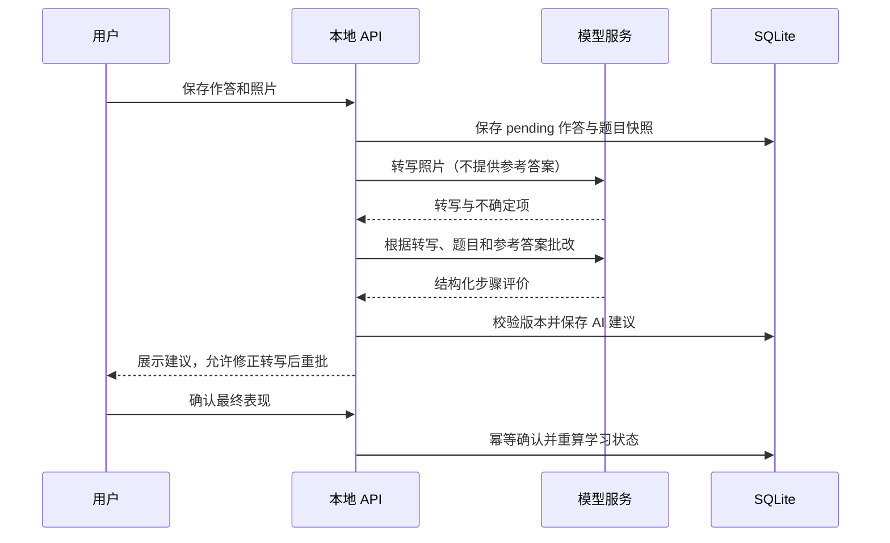

# 架构与实现边界

## 模块

| 模块 | 入口 | 职责 |
| --- | --- | --- |
| 前端 | `frontend/main.tsx` | 页面、练习与设置；CSS 分组件组织 |
| 本地 API | `backend/main.py` | 参数校验、会话校验、业务编排和版本检查 |
| 学习规则 | `backend/learning.py` | 作答重放、加权表现、复习间隔及预算内选题 |
| 模型适配 | `backend/ai.py` | Chat Completions、图片内容、JSON 解析及脱敏错误提示 |
| 检索 | `backend/rag.py` | 可重建 FTS5 索引、中文字符切分、BM25 与知识点候选 |
| 数据 | `backend/store.py` | SQLite、迁移、单机写入锁及事务 |
| 导入与备份 | `backend/imports.py`、`backend/backups.py` | Office / 图片解析、备份校验和恢复 |
| 演示分享 | `share.py`、`backend/sharing.py` | Cloudflared、口令和隔离数据库 |

## 照片批改工作流

两个模型阶段是同步请求，目前没有持久化任务队列、阶段断点恢复或自动重试。照片需视觉模型；纯文字及用户已修正的转写不再重复识图。识别阶段的不确定项会保留在最终建议中。

## 题库 RAG

1. 新增、修改、初始化或备份恢复时同步或重建索引；安装练习题时更新索引。
2. 题目正文仍保存在原表；索引和查询都使用中文单字及 ASCII 词切分，以兼容 FTS5 unicode61。
3. 在同科目、已核实题目中按 BM25 召回，并以同知识点候选补充；优先同知识点，最终最多 5 道。
4. 把当前题目、相关题目以及当前题的部分已确认历史发送给模型。模型输出经过结构校验，引用和推荐 ID 必须来自给定集合。
5. 界面显示引用题目的标题和推荐题；当前不支持段落级引用定位或检索结果交互跳转。练习提交前使用讲解会标记使用提示。

当前历史上下文只包括当前题目的已确认表现及已保存错误类型，不包括整个用户历史的语义检索。FTS5 不可用时退回同知识点候选，不宣称具有向量语义理解能力。没有足够资料时提示不确定，但提示词不能保证模型绝不产生无依据结论。

## 数据一致性

- 学习状态来自已确认作答，AI 建议不会直接修改表现指标。
- 题目有版本，作答持有原题快照；编辑题目会使未确认旧版作答过期。
- 确认采用事务与版本号，重复确认不会重复累计证据。
- SQLite 写入及恢复通过进程内锁串行；设计目标是单进程个人使用，不支持分布式多实例。
- 检索索引是派生数据，数据库恢复后重建；模型配置与密钥沿用本机设置。

## 验证方式

协议和业务测试使用模拟模型与临时数据库；截图使用独立示例数据库。真实 DeepSeek 文本调用有手动连通性验证，但没有公开批改准确率、RAG 命中率或学习增益数据。GitHub Actions 的远程结果与本地测试分别报告。
